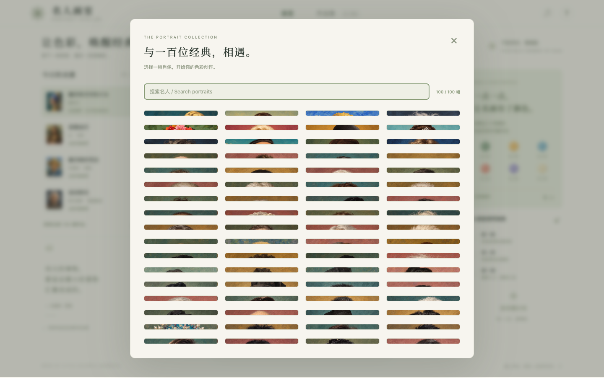

# 名人画室 · Portrait Atelier

[在线游玩 →](https://jdb156158.github.io/CelebrityMatch-3/)

[](https://jdb156158.github.io/CelebrityMatch-3/)

根据参考视频制作的蜂窝叠色消除小游戏：放置色块 → 同色聚合 → 叠满消除 → 肖像上色。

- 开场名画融化：彩色肖像拉成液态颜料流入棋盘，留下等待重新上色的灰度底稿。
- 19 格六边形棋盘，支持点击、拖放和键盘操作。
- 相邻同色堆自动聚合，顶层满 6 片消除；底层露出后可触发连续消除。
- 6 种颜料，每色收集 12 片，完成一幅肖像。
- 100 幅可直接选择的 AI 绘制肖像，覆盖中外科学家、作家、艺术家、影视音乐人物和运动员；支持中文名、英文名和常用昵称搜索。
- 9 张分组肖像图集，新增素材使用 WebP；全部支持融化开场和逐步上色，原有作品编号及收藏记录保留。
- 撤销、换色、画笔救场、轻柔音效、作品收藏及本地保存。
- 电脑与手机响应式布局。无倒计时。

## 本地运行

```sh
python3 -m http.server 4173 -d dist
```

打开 [http://localhost:4173](http://localhost:4173)。纯 HTML / CSS / JavaScript，无须安装依赖或构建。

键盘：`1 / 2 / 3` 选择色块，方向键选择棋盘格，`Enter` 放置，`Esc` 取消。

## 检查

```sh
node --test tests/*.test.js
node --check dist/app.js
```

[验证记录](docs/verification.md) · [视频拆解与规则](docs/reference-analysis.md) · [100 幅肖像目录](docs/portrait-catalog.md) · [图像素材与生成提示](docs/art-assets.md)

GitHub Actions 验证规则后自动将 `dist/` 发布到 GitHub Pages。
